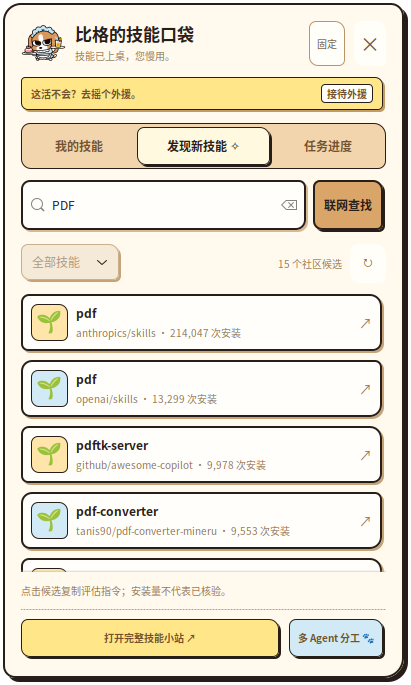

<p align="center"></p>

# 比格的技能口袋 🐶

**你说要干嘛，比格找技能、组队开工、交回成果。**

一只趴在桌面的比格。鼠标移过去，打开技能口袋；选择技能、填写任务和附件，就能让本机 Codex 执行，并查看真实进度与结果。支持选择账号实际可用的执行模型。每项任务会在所选工作文件夹建立持久对话，可从“打开 Codex 对话”进入对应项目下的聊天。

**[⬇ 下载 Linux 安装入口](https://github.com/sss836/Beagle_skill_Pocket/releases/latest/download/beagle-one-click-0.3.3.zip)** · **[全部安装包](https://github.com/sss836/Beagle_skill_Pocket/releases/latest)** · **[详细安装说明](docs/INSTALL.md)**

## 快速安装

### Linux 桌宠 + 两个插件

已验证环境：Ubuntu、Python 3.12、GTK 3。需要先安装 Codex，使用自己的账号登录。

1. 下载上面的安装入口 ZIP，解压。
2. 双击 `Install-Beagle.desktop`。桌面环境若提示，先选择“允许启动”或将它标记为可执行文件。
3. 程序会检查依赖，安装桌宠和两个插件，并启动比格。首次开工时选择自己的工作文件夹。

若系统不允许运行下载的桌面入口，打开终端执行下面这一条命令即可安装：

```bash
curl -fL https://raw.githubusercontent.com/sss836/Beagle_skill_Pocket/v0.3.3/install.sh -o /tmp/beagle-install.sh && bash /tmp/beagle-install.sh
```

缺少图形依赖时，安装程序会显示所需命令；Ubuntu / Debian 可先运行：

```bash
sudo apt install python3-gi python3-cairo python3-gi-cairo gir1.2-gtk-3.0
```

所有比格文件安装到当前用户目录。升级保留工作文件夹设置、任务记录与桌宠位置；已有不同内容的同名个人技能会提示冲突，由使用者处理。

### 只安装 Codex 插件

已安装 Codex CLI 的用户可以直接运行：

```bash
codex plugin marketplace add sss836/Beagle_skill_Pocket --ref v0.3.3
codex plugin add beagle-skills@beagle-local
codex plugin add beagle-desktop@beagle-local
```

重新打开一个会话，在插件中选择“比格技能口袋”或“比格直接开工”。如果你的 Codex 版本只支持插件目录界面安装，添加此仓库来源后，在插件目录中点击安装。

| 安装内容 | 提供什么 | 支持范围 |
| --- | --- | --- |
| `beagle-skills` 比格技能口袋 | 技能导航、按目标组合技能、多 Agent 分工 | 支持该插件格式的宿主；具体执行能力由宿主提供 |
| `beagle-desktop` 比格直接开工 | 提交任务、模型列表、进度、成果、取消、工作文件夹 | 需要本机执行环境、Python 3.11+ 和已登录的 Codex；Linux 已验证 |
| Linux 比格桌宠 | 桌面悬浮比格、技能筛选、发现新技能、任务窗口与网页看板 | Linux 图形桌面；Windows / macOS 桌宠尚未适配 |

只需要技能导航的用户，安装第一个插件即可。

## 怎么用

- **桌宠开工：** 鼠标移到比格 → 选技能 → 写需求、选模型和工作文件夹 → 开工。
- **在 Codex 中：** “使用比格直接开工，在我指定的文件夹整理这份资料，返回任务 ID，并查看真实进度。”
- **多 Agent 协作：** “使用多 Agent 指挥官，拆分这项任务，安排实施与独立验收，最后整合交付。”
- **找新技能：** 输入目标搜索社区候选，先查看来源和适用范围，再决定是否安装。

技能列表来自每个人本机已安装的技能，数量会不同。这个仓库只包含本项目的三个技能，不复制作者电脑上的第三方技能。模型列表也来自使用者自己的 Codex 账号。

<p></p>

## 分享给 ChatGPT 用户

直接把这个仓库链接发给朋友即可：

**https://github.com/sss836/Beagle_skill_Pocket**

目前提供 GitHub 仓库安装与 Linux 桌宠安装包。支持本地插件的 ChatGPT / Codex 桌面环境，可通过本地插件来源安装；本机任务连接层仍以 Linux 为已验证环境。

普通 ChatGPT 网页版不能从 GitHub 自动获得桌面执行权限。要在 ChatGPT 公共插件目录中搜索并点击安装，还需经过[官方提交与发布流程](https://developers.openai.com/plugins/deploy/submission)。此仓库发布不代表已经上架官方目录。本地 MCP 的额外要求见[桌面插件说明](https://developers.openai.com/plugins/deploy/desktop-only)。

## 数据与运行

比格通过 `codex app-server` 使用本机 Codex 的登录状态，不打包账号或 API Key。服务只监听本机地址，任务只在使用者选择的工作文件夹执行。需要批准或补充信息时，在任务看板处理。

关闭任务窗口后任务继续运行；“停止任务”才会中断，且不会撤销已写入文件。电脑或服务重启后未完成任务会标记为中断，不自动重跑。

## 开发与构建

```bash
python3 -m unittest discover -s desktop/skill-station -p 'test_*.py'
python3 tools/build.py
bash install.sh --check
```

`plugins/` 是可直接加载的插件；`desktop/` 是桌宠与连接层源码；`dist/` 是重新构建的发布 ZIP 和 SHA256 校验表。安装器选项见 `bash install.sh --help`。

官方插件打包与仓库源说明：[OpenAI Docs](https://developers.openai.com/plugins/build/plugins)。第三方组件说明见 [THIRD_PARTY_NOTICES.md](THIRD_PARTY_NOTICES.md)。
